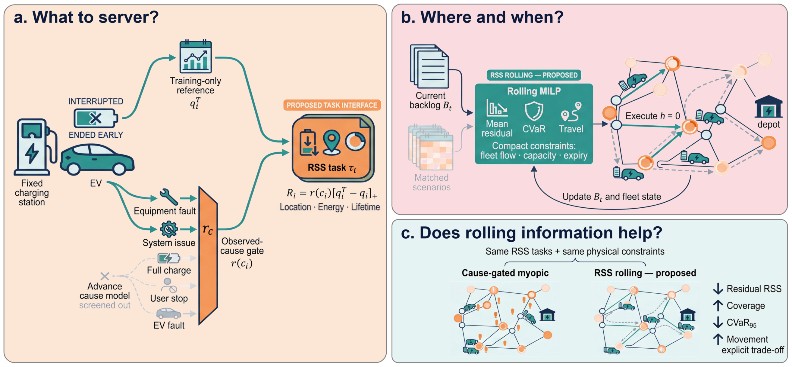
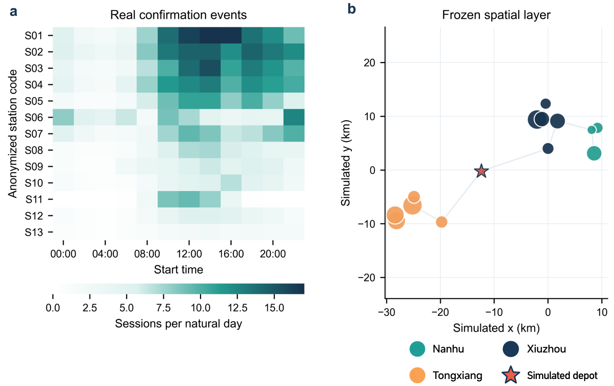

# RSS-driven EDVF dispatch for fixed-mobile charging coordination

Official implementation accompanying the *Vehicles* article:

> **Recoverable Service Shortfall-Driven Dispatch for Fixed-Mobile Charging Coordination: Exponential Deadline-Viability Flow on Real Transaction Event Streams.**

This repository implements recoverable service shortfall (RSS) construction and
exponential deadline-viability flow (EDVF) dispatch for coordinating fixed
charging stations with mobile charging vehicles. It provides the EDVF Exact and
Sparse solvers, the Jiaxing transaction replay, UrbanEV spatial inputs, runnable
examples, and experiment summaries.

## Method overview

<p align="center">
  
</p>

Abnormally terminated charging sessions are converted into RSS tasks using a
training-only normal-delivery reference and an observed-cause gate. Each task
has a location, an energy shortfall, and a finite response window. EDVF updates
the mobile fleet over rolling horizons while accounting for backlog aging,
task expiration, vehicle travel, and in-transit states.

<p align="center">
  
</p>

The Jiaxing experiment replays real transaction events on a fixed spatial
topology. Figure 2 shows the event distribution and the station-level spatial
context used in the study.

## Main results

The 153-day Jiaxing comparison applies the same RSS tasks, response window,
fleet, vehicle capacity, topology, and execution rules to every policy.

| Method | Coverage (%) | Movement (km/day) | Unrecovered RSS (kWh/day) | Runtime (s/day) |
|---|---:|---:|---:|---:|
| **EDVF-RSS** | **93.82** | 286.41 | **74.56** | 8.73 |
| Myopic | 88.74 | 226.58 | 126.83 | 2.64 |
| Nearest-RSS | 87.91 | **205.40** | 137.24 | 0.05 |
| EDF-Reactive | 78.63 | 401.36 | 241.57 | 0.03 |
| Deterministic-Forecast-RSS | 89.64 | 332.87 | 115.62 | 7.90 |
| Scenario-Sampling-RSS | 85.91 | 364.73 | 158.42 | 24.16 |
| Perfect-Future-Oracle | 94.61 | 278.95 | 63.27 | 4.81 |

## Installation

Python 3.10 or later is recommended.

```bash
python -m venv .venv
```

Activate the environment and install the package:

```bash
# Windows PowerShell
.venv\Scripts\Activate.ps1

# macOS / Linux
source .venv/bin/activate

python -m pip install -e .
```

## Quick start

```bash
python examples/run_vehicles_demo.py
```

The example runs EDVF Exact and Sparse on a deterministic synthetic instance,
replays one Jiaxing test day, writes a JSON summary to `outputs/demo/`, and
generates the accompanying diagnostic plots in `docs/figures/`.

Run the test suite with:

```bash
python -m unittest discover -s tests -v
```

## Python API

`simulate_independent_day` accepts one day of RSS arrivals, historical RSS
profiles, an inter-node distance matrix, and a dispatch configuration. RSS
arrays have shape `[48, n_nodes]`, representing 48 half-hour decision slots.
Node 0 is the initial depot.

```python
import numpy as np

from edvf_rss import DispatchConfig, simulate_independent_day

rss = np.zeros((48, 4))
rss[8, 1] = 24.0
rss[12, 3] = 35.0

distance_km = np.array([
    [0.0, 8.0, 12.0, 18.0],
    [8.0, 0.0, 10.0, 15.0],
    [12.0, 10.0, 0.0, 9.0],
    [18.0, 15.0, 9.0, 0.0],
])

config = DispatchConfig(
    fleet=4,
    capacity_kwh=20.0,
    response_slots=4,
    max_relocation_km=30.0,
)

result = simulate_independent_day(
    actual_rss=rss,
    signal_cube=rss,
    history_signal=np.stack([rss]),
    forecast_indices=np.array([0]),
    distance=distance_km,
    cfg=config,
    policy="EDVF-RSS-Exact",
    include_future=False,
)

print(f"coverage: {result.coverage:.2%}")
print(f"unrecovered RSS: {result.residual_rss_kwh:.2f} kWh")
print(f"movement: {result.movement_km:.2f} km")
```

Available implementations:

- `EDVF-RSS-Exact`: three-stage mixed-integer EDVF optimization.
- `EDVF-RSS-Sparse`: candidate-pruned EDVF for larger networks.

## Data

### Jiaxing charging transactions

The official public source is the versioned
[Figshare dataset record](https://doi.org/10.6084/m9.figshare.28182251.v3).
The dataset contains 441,077 charging transactions from 13 stations. This
repository includes both a
[mirror of the original v3 archive](data/jiaxing/jiaxing_figshare_v3.zip) and
the cleaned replay input at `data/jiaxing/jiaxing_transactions_clean.parquet`.
The replay adapter is `data/jiaxing/run_jiaxing_event_dispatch.py`.

### UrbanEV

The public [UrbanEV dataset record](https://doi.org/10.5061/dryad.np5hqc04z)
is hosted by Dryad. The
[latest complete archive](https://datadryad.org/downloads/file_stream/4587805)
is available from the official record. The station metadata, rated power, and
inter-station distance inputs used here are included under `data/urbanev/`.

See `data/README.md` for the complete file list.

## Repository structure

```text
Vehicles-EDVF-opensource/
|-- edvf_rss/                       # EDVF solvers and RSS replay engine
|-- data/
|   |-- jiaxing/                    # Cleaned transactions and replay adapter
|   `-- urbanev/                    # Station metadata and spatial inputs
|-- docs/figures/                   # Paper and diagnostic figures
|-- examples/run_vehicles_demo.py   # End-to-end runnable example
|-- results/                        # Experiment and audit summaries
|-- tests/                          # Conservation and dispatch tests
|-- config.example.toml             # Optional path configuration
|-- requirements.txt
`-- pyproject.toml
```

## Citation

```bibtex
@article{zhi2026vehicles_edvf,
  title   = {Recoverable Service Shortfall-Driven Dispatch for Fixed-Mobile Charging Coordination: Exponential Deadline-Viability Flow on Real Transaction Event Streams},
  author  = {Zhi, Jianing and Chen, Zidong and Li, Xinghua},
  journal = {Vehicles},
  year    = {2026}
}
```

## License

The source code is released under the [MIT License](LICENSE). The Jiaxing data
is distributed under [CC BY 4.0](https://creativecommons.org/licenses/by/4.0/),
and UrbanEV is distributed under
[CC0 1.0](https://creativecommons.org/publicdomain/zero/1.0/). See
`data/README.md` for dataset attribution and download links.
